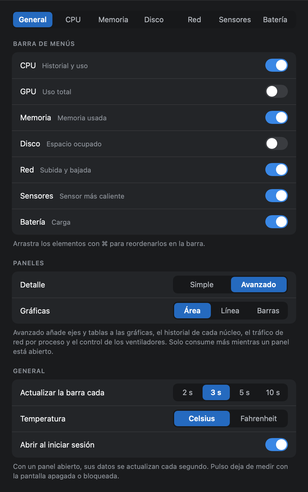

# Instalar Pulso

## Requisitos

- Un Mac con Apple Silicon (M1 o posterior). No hay versión para Intel.
- macOS 14 (Sonoma) o posterior.

Pulso solo se ha probado en un MacBook Pro M1 Pro con macOS 27. En otros equipos debería
funcionar, pero las temperaturas pueden salir incompletas (ver [Problemas frecuentes](#problemas-frecuentes)).

## Instalar desde el DMG

1. Descarga `Pulso-0.1.0.dmg` de la [última versión](https://github.com/jorgenchu/pulso/releases/latest).
2. Ábrelo y arrastra **Pulso** a la carpeta **Applications**.
3. Abre Pulso desde Aplicaciones.

### La primera vez: permitir la app

Pulso no está notarizado por Apple, así que la primera vez macOS avisa de que no puede
verificarlo y no lo abre. Solo hay que permitirlo una vez:

- **macOS 15 o posterior:** abre **Ajustes del Sistema → Privacidad y seguridad**, baja hasta
  el aviso sobre Pulso y pulsa **Abrir igualmente**.
- **macOS 14:** haz clic derecho sobre Pulso en Aplicaciones, elige **Abrir** y confirma.

También se puede hacer desde Terminal, en cualquier versión:

```bash
xattr -dr com.apple.quarantine /Applications/Pulso.app
```

## Primeros pasos

Pulso no tiene icono en el Dock ni ventana principal: vive en la barra de menús.


- **Clic** en un elemento: abre su panel.
- **Clic derecho**: Ajustes y Salir.
- **⌘ + arrastrar**: reordena los elementos.
- Abrir Pulso otra vez mientras está en marcha muestra los ajustes.

En **Ajustes** se elige qué elementos aparecen en la barra, cada cuánto se actualizan y el
nivel de detalle de los paneles. Hay una pestaña por módulo para decidir qué dato enseña su
elemento y qué secciones tiene su panel.



**Detalle → Avanzado** añade ejes y tablas a las gráficas, el historial de cada núcleo, el
tráfico de red por proceso y el control de los ventiladores.

<p>
  
  
  
</p>

**Abrir al iniciar sesión** está en Ajustes → General. Necesita que la app esté en
Aplicaciones.

## Control de ventiladores (opcional)

Cambiar la velocidad de los ventiladores exige permisos de administrador, así que Pulso lo
hace a través de un pequeño servicio que se instala aparte, una sola vez, desde Terminal:

```bash
sudo /Applications/Pulso.app/Contents/Resources/install-fan-helper.sh
```

Pide tu contraseña y debe terminar con «Servicio de ventiladores instalado». Después, con el
detalle en **Avanzado**, el panel de **Sensores** muestra el interruptor **Automático / Manual**
y un deslizador por ventilador.

Lo que instala: el programa `/Library/PrivilegedHelperTools/com.jorgenchu.pulso.fand` y su
arranque automático en `/Library/LaunchDaemons/com.jorgenchu.pulso.fand.plist`. El servicio:

- solo acepta órdenes del usuario que lo instaló;
- ajusta cada velocidad al rango del propio ventilador;
- devuelve los ventiladores al sistema si la CPU llega a 95 °C, si Pulso se cierra o deja de
  responder durante 30 segundos, o si el servicio se detiene.

Una velocidad fija y baja con el equipo trabajando hace que se caliente más. Si usas otra
aplicación que controle los ventiladores, no las uses a la vez.

Para quitarlo:

```bash
sudo /Applications/Pulso.app/Contents/Resources/uninstall-fan-helper.sh
```

## Actualizar

Sal de Pulso (clic derecho en un elemento → Salir), arrastra la versión nueva a Aplicaciones
y reemplaza la anterior. Si tienes instalado el servicio de ventiladores, vuelve a ejecutar
su instalador para actualizarlo también.

## Desinstalar

1. En Ajustes → General, desactiva **Abrir al iniciar sesión**.
2. Si instalaste el servicio de ventiladores, quítalo antes de borrar la app (el
   desinstalador va dentro de ella):

   ```bash
   sudo /Applications/Pulso.app/Contents/Resources/uninstall-fan-helper.sh
   ```

3. Sal de Pulso y arrastra la app a la Papelera.
4. Para borrar también las preferencias:

   ```bash
   defaults delete com.jorgenchu.pulso
   ```

## Compilar desde el código

Hace falta Xcode 15.3 o posterior (o sus herramientas de línea de órdenes). No hay
dependencias externas.

```bash
git clone https://github.com/jorgenchu/pulso.git
cd pulso
scripts/build-app.sh          # genera build/Pulso.app
open build/Pulso.app
```

```bash
swift test                    # tests del motor
scripts/make-dmg.sh           # genera build/Pulso-<versión>.dmg
```

Desde el código, el servicio de ventiladores se instala con `sudo scripts/install-fan-helper.sh`.

## Problemas frecuentes

**macOS dice que no puede abrir Pulso o que no puede verificarlo.** Es el aviso de las apps
sin notarizar. Sigue [La primera vez: permitir la app](#la-primera-vez-permitir-la-app).

**No veo los elementos en la barra de menús.** Si la barra está llena, macOS esconde los
elementos que no caben; pasa sobre todo en portátiles con muesca. Cierra otros iconos de la
barra o desactiva en Ajustes los módulos que no necesites.

**Faltan temperaturas o no distingue los núcleos.** Apple no documenta los sensores y cambian
con cada chip. Las tablas de M2 a M4 vienen de ingeniería inversa de la comunidad y no están
comprobadas en hardware real; para otros chips se muestra una media.

**El panel de Sensores dice que falta el servicio de ventiladores.** Instálalo como se explica
en [Control de ventiladores](#control-de-ventiladores-opcional). Leer las velocidades no lo
necesita; cambiarlas, sí.

**Los ventiladores vuelven solos a automático.** Es lo esperado si la CPU llega a 95 °C o si
Pulso se cierra.
