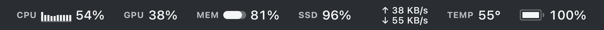
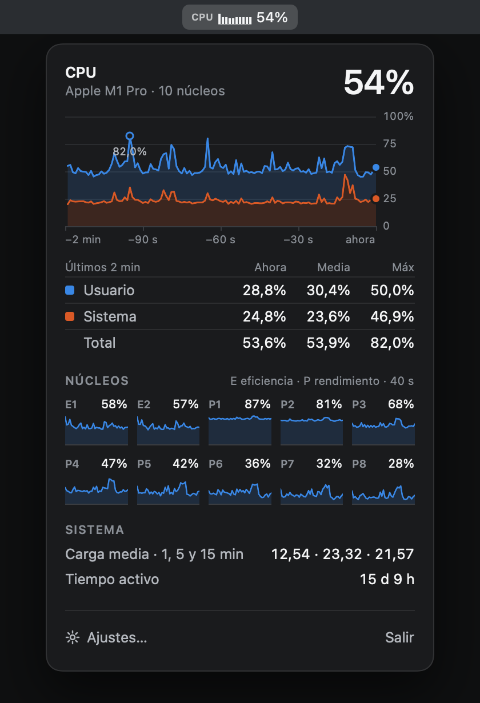
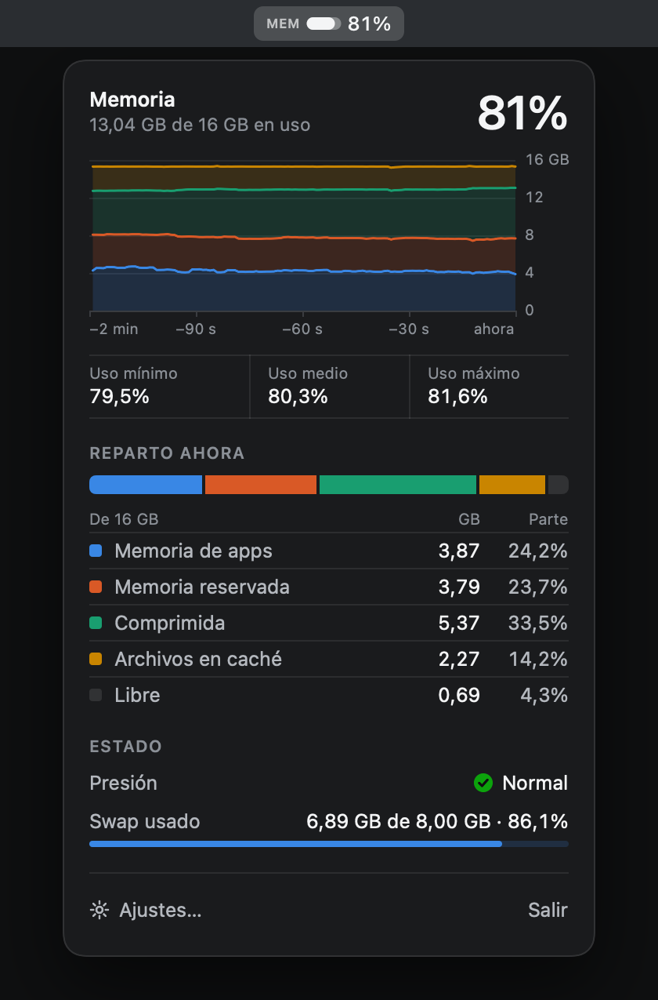
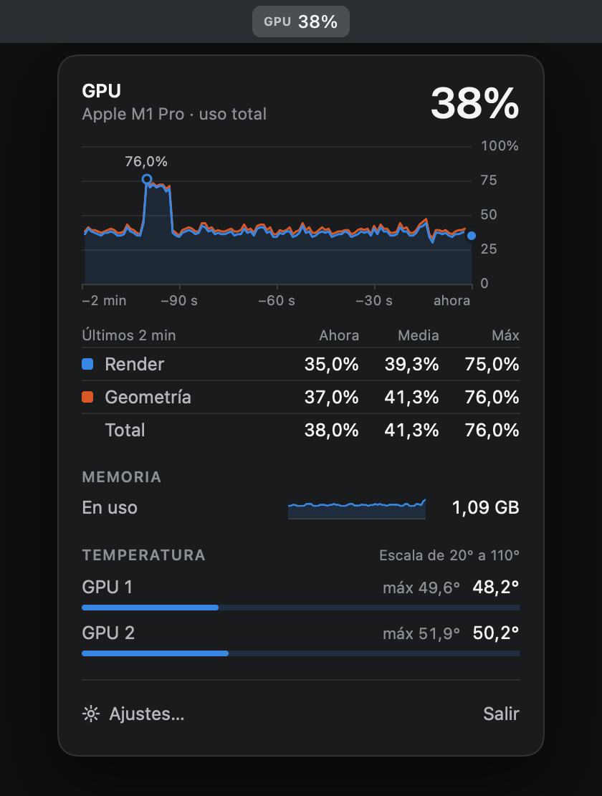

# Pulso

Monitor del sistema para la barra de menús de macOS, al estilo de iStat Menus: CPU, GPU,
memoria, disco, red, sensores (temperaturas, ventiladores, potencia) y batería, cada uno
como un ítem independiente con su panel desplegable.



<p>
  
  
  
</p>

Nativo en Swift (AppKit + SwiftUI), sin dependencias externas. Requiere un Mac con Apple
Silicon y macOS 14 o superior. Desarrollado y verificado en un MacBook Pro 16" M1 Pro con
macOS 27.2.

## Instalación

Descarga el DMG de la [última versión](https://github.com/jorgenchu/pulso/releases/latest) y
arrastra Pulso a Aplicaciones. La app no está notarizada, así que la primera vez hay que
permitirla en Ajustes del Sistema → Privacidad y seguridad. Los pasos completos, el control
de ventiladores y la desinstalación están en [INSTALACION.md](INSTALACION.md).

## Uso

```bash
scripts/build-app.sh          # compila en release y genera build/Pulso.app
open build/Pulso.app
scripts/make-dmg.sh           # empaqueta la app en build/Pulso-<versión>.dmg
```

Clic en un ítem abre su panel; clic derecho abre el menú con Ajustes y Salir. Los ítems se
reordenan arrastrándolos con ⌘. Volver a abrir la app mientras está en marcha muestra los ajustes.

```bash
swift test                                   # tests del motor
swift run pulsoctl snapshot --processes      # una muestra completa en JSON
swift run pulsoctl watch 1                   # una línea por segundo
swift run pulsoctl sensors                   # todos los sensores y las claves SMC en bruto
swift run pulsoctl bench                     # coste de cada lector
swift run pulsoctl traffic                   # procesos que más red usan
swift run pulsoctl fan                       # estado de los ventiladores
build/Pulso.app/Contents/MacOS/Pulso --render-snapshots build/snapshots
build/Pulso.app/Contents/MacOS/Pulso --open-panel cpu    # arranca con ese panel abierto
```

### Control de ventiladores

Escribir en la SMC exige root, así que cambiar la velocidad de los ventiladores necesita un
servicio con privilegios, `pulso-fand`. Se instala una vez, a mano. La app construida con
`scripts/build-app.sh` lo lleva dentro, con su instalador en `Contents/Resources`; desde el
código se compila al instalar:

```bash
sudo scripts/install-fan-helper.sh
```

```bash
swift run pulsoctl fan set 0 2600            # ventilador 0 a 2600 rpm
swift run pulsoctl fan auto                  # devolverlos todos al sistema
sudo scripts/uninstall-fan-helper.sh
```

El servicio solo acepta órdenes del usuario que lo instaló y aplica él mismo las protecciones:
ajusta cada velocidad al rango del propio ventilador, devuelve los ventiladores al sistema si la
CPU llega a 95 °C (y no acepta el modo manual hasta que baja de 85 °C), si la app deja de dar
señales durante 30 s, o si lo detienen. Con todo en automático duerme sin consumir nada.

`--render-snapshots` renderiza a PNG, con datos reales y en oscuro y claro, la barra, cada panel
en sus dos niveles de detalle, cada pestaña de ajustes y una hoja de componentes, y termina.
Cada imagen está compuesta como su tablero del diseño, para compararlas. Tarda un minuto, lo
que cuesta llenar los dos minutos de historial; `--samples N` lo acorta. `--open-panel` arranca
la app con un panel abierto, para verlo en pantalla sin usar el ratón.

## Estructura

| Módulo | Contenido |
|---|---|
| `Sources/CPulso` | C mínimo para lo que Swift no puede importar: AppleSMC, las llamadas privadas de sensores IOHID y los contadores de red de 64 bits. |
| `Sources/PulsoCore` | Un lector por métrica (`Samplers/`) y `SystemMonitor`, que muestrea en una cola en segundo plano y publica en la principal. Sin interfaz. |
| `Sources/pulsoctl` | CLI de diagnóstico sobre el motor. |
| `Sources/pulso-fand` | Servicio root que fija la velocidad de los ventiladores. Las reglas que aplica están en `PulsoCore/FanControl.swift`. |
| `Sources/Pulso` | La app: `Theme.swift` (colores, tipografía y medidas del diseño «Instrumento»), `MenuBar/` (ítems, render, panel), `Panel/` (una vista por módulo, en modo simple y avanzado, sobre componentes comunes), ajustes. |

La app no usa sandbox: leer la SMC y los sensores lo impide, así que no puede ir a la Mac App Store.
Se firma ad hoc y no está notarizada, de modo que macOS pide permitirla la primera vez; para
evitarlo haría falta firma con Developer ID y notarización.

## Requisitos técnicos

Estado a 12 de octubre de 2026. "Contrastado" significa comparado en este equipo con la
herramienta del sistema indicada.

| Requisito | Estado | Cómo se comprobó |
|---|---|---|
| CPU total, usuario/sistema, por núcleo, clústeres P/E, carga media | Hecho | Contrastado con `top` y `uptime` |
| GPU: uso y memoria | Hecho | Lectura de `IOAccelerator`; valor coherente con la carga |
| Memoria: apps, reservada, comprimida, caché, swap, presión | Hecho | Contrastado con `vm_stat` y `sysctl vm.swapusage` (diferencia < 3 %) |
| Disco: espacio por volumen como lo muestra Finder | Hecho | Contrastado con `df` |
| Disco: lectura/escritura | Hecho | Contrastado con `iostat` (diferencia ~3 %) |
| Red: subida/bajada, interfaz principal, IP | Hecho | Contrastado con `netstat -ib` |
| Temperaturas por núcleo, GPU, SSD, batería, carcasa | Hecho en M1 | Claves SMC leídas y coherentes con la carga. Ver límites |
| Ventiladores: rpm y rango | Hecho | 2 ventiladores leídos, dentro de su rango |
| Potencia del sistema y del adaptador | Hecho | Coherente con voltaje × corriente de la batería |
| Batería: carga, estado, tiempo, ciclos, salud, temperatura | Hecho | Contrastado con `pmset -g batt` e `ioreg` |
| Procesos que más CPU y memoria usan | Hecho | Incluye procesos de otros usuarios (WindowServer, etc.) |
| Tráfico de red por proceso | Hecho en el motor | `pulsoctl traffic` coherente con `netstat`; excluye el tráfico local. En la app, en el panel de Red del modo avanzado |
| Control de ventiladores | Hecho desde la línea de órdenes; el panel, sin probar a fondo | Con el servicio instalado, `pulsoctl fan` fijó una velocidad real (de 0 a 2600 rpm en unos 8 s), ajustó al mínimo una petición por debajo del rango, rechazó un ventilador inexistente, y devolvió los ventiladores al sistema al pedirlo y a los 31 s sin contacto. El corte a 95 °C solo está cubierto por tests. El control del panel de Sensores (modo avanzado) no se ha probado de forma sistemática |
| Pausar el muestreo con la pantalla apagada | Hecho en el motor | `SystemMonitor.pause()` / `resume()`; la app los llama al dormirse las pantallas y al bloquear la sesión. Sin comprobar en vivo |
| Cadencias separadas: la barra a su intervalo (2/3/5/10 s, el doble en Modo de bajo consumo) y el panel abierto cada segundo | Hecho, sin medir | Con un panel abierto se muestrea cada segundo pero los ítems solo se repintan a su intervalo. Falta medir el consumo resultante |
| Un ítem de barra por módulo (siete, con la GPU), activable y reordenable | Hecho | Render comparado con el tablero del diseño y visto en la barra real |
| Panel desplegable por ítem, en modo simple y avanzado | Hecho, clics sin automatizar | Cada panel comparado con su tablero del diseño. En pantalla real, abierto con `--open-panel`: cuelga centrado bajo su ítem y se refresca cada segundo. Abrirlo y cerrarlo con el ratón no se ha podido automatizar (falta permiso para controlar el ratón) |
| Ajustes persistentes: módulos, detalle, intervalo, °C/°F y opciones por módulo (dato del ítem, gráfica, núcleos, secciones del panel) | Hecho, clics sin automatizar | Cada pestaña renderizada; la ventana real se abre al frente al relanzar la app |
| Abrir al iniciar sesión | Implementado, sin verificar | `SMAppService`; necesita la app instalada en `/Applications` |
| Consumo bajo | Hecho | Ver abajo |
| Tests automáticos del motor | Hecho | 81 tests, todos en verde |

### Consumo

Medido con la app en marcha (4 ítems, cada 2 s, paneles cerrados) a la vez que iStat Menus,
durante el mismo minuto. El equipo estaba saturado por otra compilación (carga media ~890),
así que los valores absolutos están inflados; lo que vale es la comparación.

| | CPU en 60 s | % de un núcleo |
|---|---|---|
| Pulso | 1,85 s | 3,08 % |
| iStat Menus (Status + Daemon) | 5,07 s | 8,45 % |

No se conoce la configuración de iStat Menus en ese momento, así que es una referencia
orientativa. Queda pendiente repetir la medida con el equipo en reposo.

Repetida esa misma tarde con la interfaz nueva y 5 ítems, durante 30 s: Pulso 4,0 %,
iStat Menus 5,7 %. La ventaja se redujo; lo que más pesa es cuántos ítems cambian por segundo.
El tráfico por proceso es lo más caro que lee el motor (un `nettop` hijo, unos 28 ms de CPU
por muestra cada 3 s), y por eso solo corre mientras su lista está en pantalla.

El muestreo es casi gratis (unos 0,3 ms de CPU por muestra). Más del 95 % del consumo es de
AppKit en el hilo principal: cada vez que cambia el contenido de un ítem, macOS vuelve a
capturarlo a un bitmap para la barra de menús de cada pantalla adicional. Por eso la app solo
toca un ítem cuando lo que muestra ha cambiado, y por eso el coste crece con el número de
ítems, la frecuencia y las pantallas conectadas.

Memoria: unos 21 MB de huella.

## Límites conocidos

- **Temperaturas fuera de la familia M1.** Apple no documenta qué clave SMC es cada sensor y
  cambian con cada generación. `SMCSensorCatalog` trae tablas para M1 a M4 tomadas de
  ingeniería inversa de la comunidad; solo la de M1 está comprobada en hardware real. Para un
  chip sin tabla se recurre a los prefijos de las claves, que da una media representativa
  pero no distingue núcleos. En Intel no hay tabla.
- **Los sensores HID no son la CPU.** En este equipo los sensores `PMU tdie` que expone IOHID
  pertenecen al chip de gestión de energía y marcan unos 20 °C menos que los núcleos bajo
  carga. Por eso la SMC es la fuente principal y el HID solo un respaldo.
- **Lista de procesos.** Se obtiene lanzando `ps` (el único modo sin privilegios de ver
  procesos de otros usuarios), así que solo se muestrea mientras un panel que la enseña está
  abierto. La memoria de los procesos ajenos es su tamaño residente, no la huella que muestra
  Monitor de Actividad.
- **Sin nombre de la red Wi-Fi ni IP pública.** Lo primero exige permiso de localización y lo
  segundo una petición a un servicio externo.
- **Los relojes, el tiempo y las alertas** de iStat Menus no están.
- **En la pantalla integrada los ítems pueden no verse.** Con la barra de menús llena, macOS
  los deja tras el desplegable «»». En una pantalla externa sin muesca sí aparecen.

## Detalles que conviene conocer

- En macOS 27 las capacidades de la batería pasaron de la raíz de `AppleSmartBattery` al
  diccionario `BatteryData`, y la temperatura ya no se publica ahí: se toma de la SMC.
- Las imágenes de disco montadas (por ejemplo los runtimes del simulador de Xcode) son
  dispositivos de bloque. Su E/S también cuenta en el disco que las contiene, así que se
  excluyen de la actividad para no contar los mismos bytes dos veces.
- El espacio "disponible" de Finder incluye el purgable, y calcularlo es caro (CacheDelete
  recorre todos los volúmenes). Se recalcula cada 5 minutos; los bloques libres, cada 30 s.
- Los cambios de red llegan por notificación de `SCDynamicStore`, no por sondeo.
